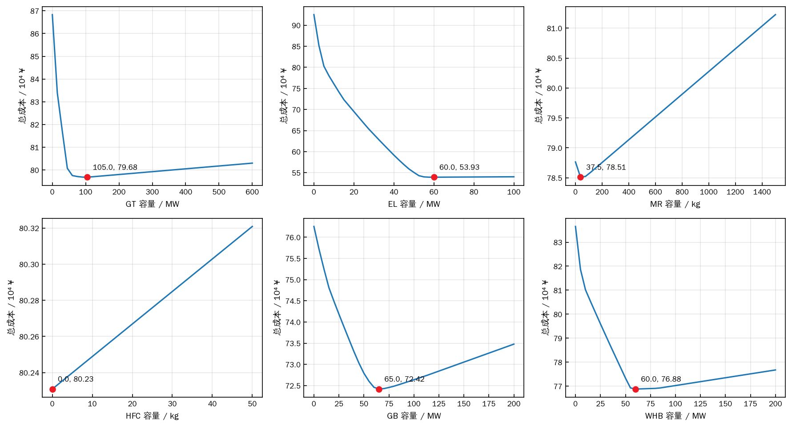
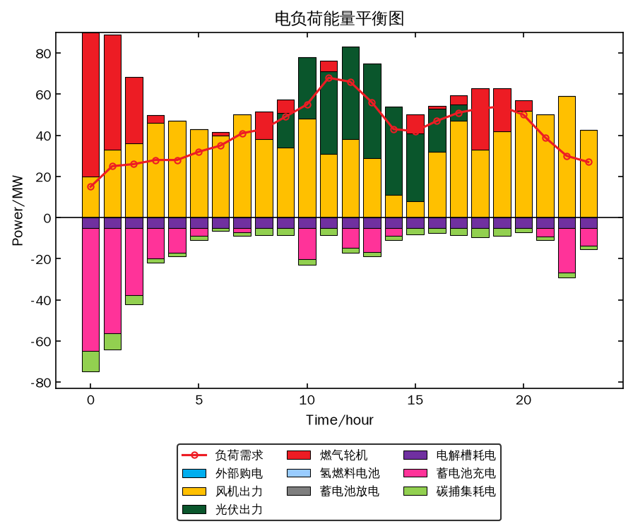
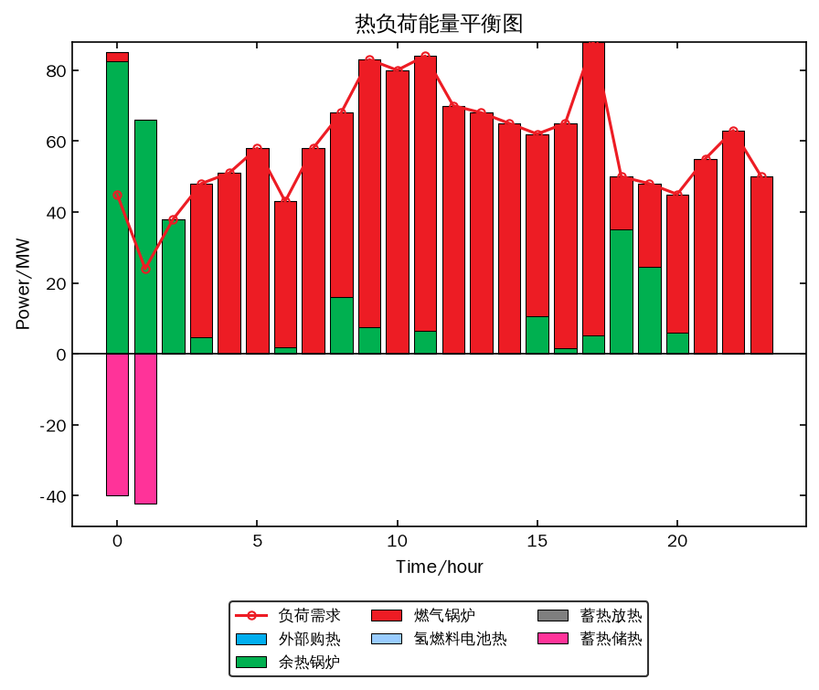
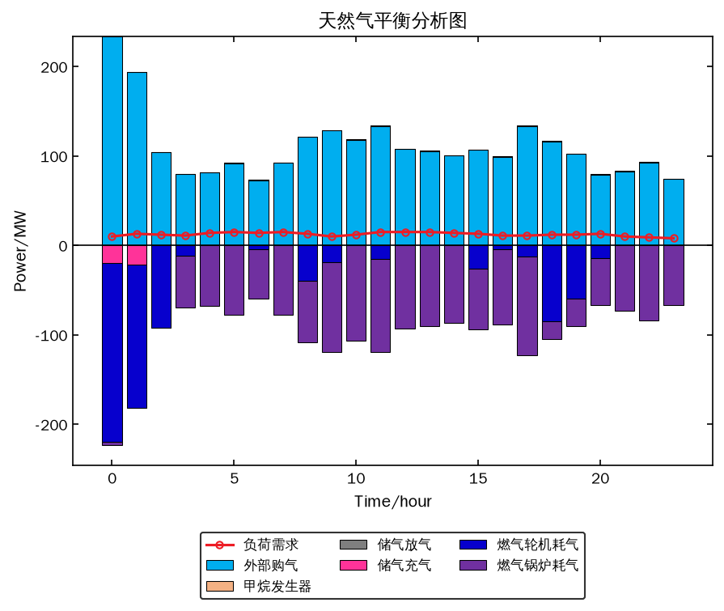
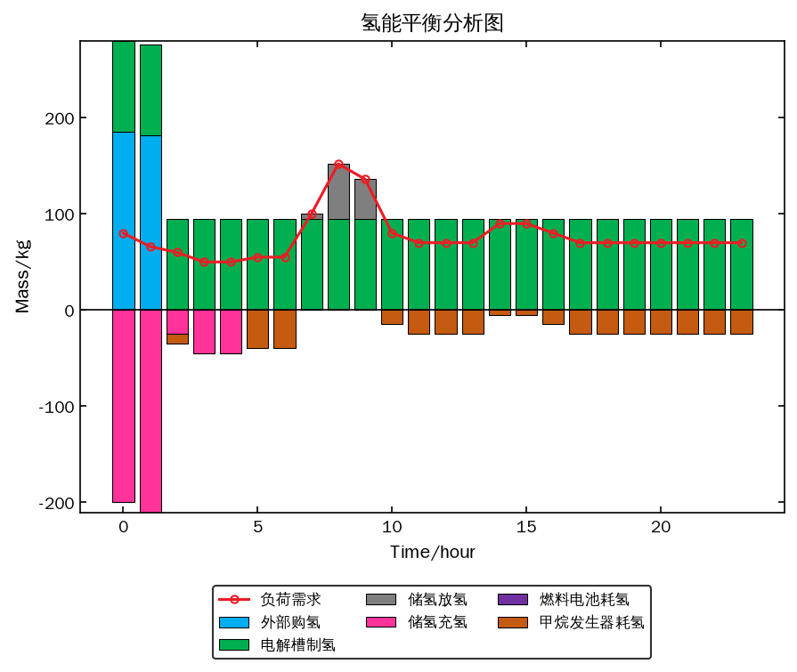
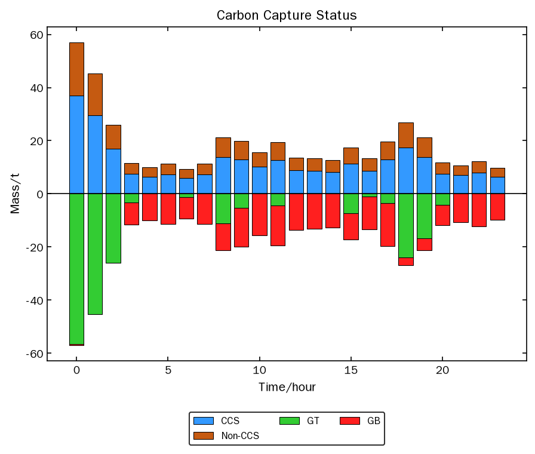
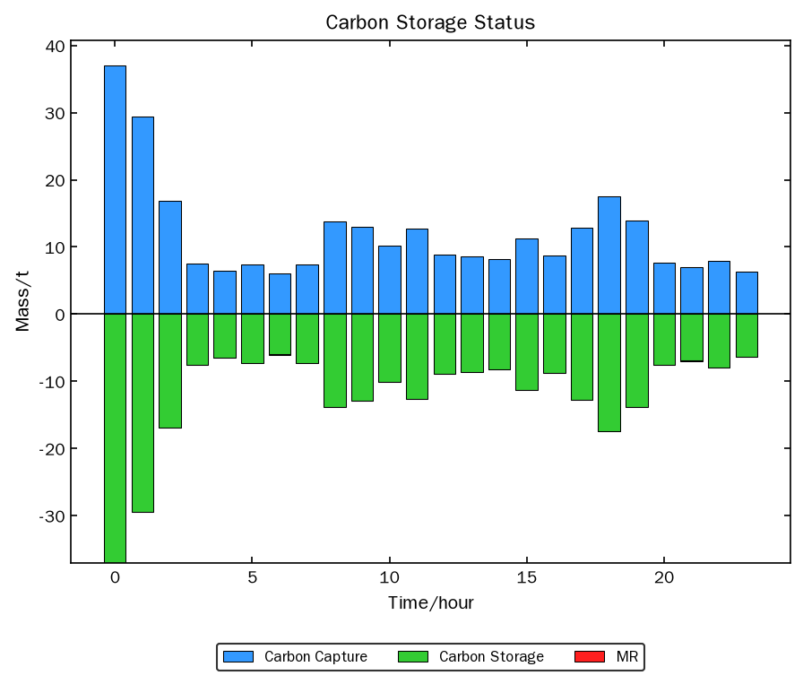

# 电–热–气–氢综合能源系统优化调度与容量配置（论文复现）

本仓库复现以下论文的优化调度模型（第 4 节）与容量配置优化（第 5 节）：

> Wang J, Liu H, Xu C. **Resource scheduling and capacity allocation optimization of an integrated electricity–heat–gas–hydrogen energy system.** *Energy*, 2025, 337: 138683.
> https://doi.org/10.1016/j.energy.2025.138683

---

## 项目简介

系统包含电、热、气、氢四种能流：

- 能源生产：风电 WT、光伏 PV、燃气轮机 GT、燃气锅炉 GB
- 能量转换：电解槽 EL、甲烷发生器 MR、氢燃料电池 HFC、余热锅炉 WHB、碳捕集 CCS
- 储能：电储能、热储能、储气罐、储氢罐（含自放电与电储能容量衰减）
- 阶梯碳交易

调度模型是 24 h 的混合整数线性规划（MILP），用 **Python + Gurobi** 建模求解。模型共 753 个变量（193 个二进制变量）、767 条约束，单次求解不到 0.1 秒。`pip install gurobipy` 自带的免费受限许可证（上限 2000 个变量和约束）即可直接运行，无需申请学术许可证。

---

## 文件结构

| 文件 | 说明 |
|---|---|
| `ies_model.py` | 完整模型：参数、建模、求解、第 5 节容量寻优（单设备搜索 + 多设备 PSO）、绘图 |
| `reproduce.ipynb` | 运行全部结果并与论文逐项对比（已包含运行输出） |
| `matlab/IES_reproduction.m` | MATLAB + YALMIP 单文件版本，与 Python 版是同一个模型，结果一致（见下文） |
| `pic/` | 本项目结果图；`org_` 前缀为论文原图 |
| `电热氢.pdf`、`电热氢——dual.pdf` | 论文原文及双语版 |

---

## 快速开始

```bash
pip install -r requirements.txt

python ies_model.py                 # 第 4 节基准调度，并与论文结果对比
python ies_model.py --plot pic      # 同上，并把 6 张结果图保存到 pic/
python ies_model.py --section5      # 第 5 节：论文各优化容量下的成本变化
python ies_model.py --literal       # 完全按论文公式字面实现求解
python ies_model.py --mode cyclic   # 储能改为日内循环口径（另有 zero_start）
```

在 Python 中调用：

```python
import ies_model as M

res = M.solve()                          # 默认参数复现论文结果
print(M.compare_with_paper(res))         # 与论文第 4 节逐项对比
M.plot_all(res.df, "pic")                # 论文 Fig.4(a)–(f)

p = M.with_capacities(M.Params(), PEL_max=60.6)       # 修改设备容量
caps, cost, _ = M.pso_capacities({"GT": (0, 600), "EL": (0, 100), "MR": (0, 2000),
                                  "HFC": (0, 50), "GB": (0, 200), "WHB": (0, 200)},
                                 n_particles=30, iters=60)   # 论文 Table 6
```

### MATLAB 版本

`matlab/IES_reproduction.m` 是同一模型的 MATLAB 实现，单个文件包含全部内容：用户设置、数据与参数、约束与求解、结果输出、画图、第 5 节容量配置，函数定义放在文件末尾。用 YALMIP 建模（与论文作者相同），求解器可选 Gurobi、CPLEX 或 intlinprog。默认参数下三种储能口径、`literal` 口径和第 5 节各容量方案的结果都与 Python 版一致（第 4 节总成本均为 802,758.9 ¥）。

使用方法：安装 YALMIP 并加入路径，打开 `IES_reproduction.m`，在“第 0 段 用户设置”中选择求解器后直接运行。

```matlab
addpath(genpath('D:\YALMIP'));   % 改成你的 YALMIP 目录
run('IES_reproduction.m')
```

- 结果图默认保存到 `pic_matlab/`，包含论文全部数据图：

  | 论文图 | 内容 | 文件 |
  |---|---|---|
  | Fig.2 | 风电、光伏可用出力 | `fig2_wt_pv_output.png` |
  | Fig.3 | 电、热、气、氢负荷 | `fig3_load_profiles.png` |
  | Fig.4(a)–(f) | 基准容量下的电/热/气/氢平衡、碳捕集、碳封存 | `fig4a_…` ~ `fig4f_…` |
  | Fig.5(a)–(f) | 六台设备容量与总成本的关系 | `fig5_capacity_sweep.png` |
  | Fig.7(a)–(f) | 优化容量（论文 Table 6）下的调度 | `fig7a_…` ~ `fig7f_…` |
  | Fig.8 | 优化前风光可用与实际利用出力 | `fig8_wt_pv_utilization.png` |
  | Fig.9 | 优化后 CHP、WHB、EL、MR 的能量损失 | `fig9_energy_loss.png` |
  | Fig.10 | 氢价与总成本，容量优化前后对比 | `fig10_hydrogen_price.png` |
  | Fig.11 | 非最优调度、最优调度、最优容量下最优调度的成本对比 | `fig11_cost_comparison.png` |

  Fig.1（系统结构图）和 Fig.6（寻优流程图）是示意图，不属于数据图，未包含。Fig.11 的 20 个非最优工况论文未说明生成方法，这里用随机扰动价格（±30%）求得的调度、再按真实价格计算成本来构造。Fig.5 需要求解约 200 次，可在“第 0 段”中调大 `sweep_step` 或关闭 `run_fig5`。
- 修改参数：`p = ies_params('PEL_max', 60.6);`，按论文公式字面实现：`p = ies_params('literal');`。
- 六设备 PSO（第 7 段）默认关闭，需要求解约 1,800 次，YALMIP 每次求解都要重新建模，耗时远长于 Python 版，建议先调小粒子数和代数试跑。
- 不要用 `sdpsettings` 设置 `gurobi.*` 参数：只要改动其中任何一项，YALMIP 会把整套默认参数传给 Gurobi，新版 Gurobi 会因 `TuneTimeLimit = -1` 报错（error 10008）。

---

## 复现说明（重要）

按论文公式的字面写法无法得到论文报告的结果。根据论文中的数据和原图反推，作者的实际实现有三处与公式写法不同。本项目默认按作者的实际实现，`Params.literal()` / `--literal` 保留字面写法供对比。

### 1. 储能约束：原来的“无可行解”问题

**不可行的真正原因是 0.3 被乘了两次。** Eq.(20) 中所有储能限值都是 Pmax_n 的比例：充放功率 ≤ 0.3·Pmax_n，库存 0.2·Pmax_n ~ 0.9·Pmax_n，首时段充电 ≥ 0.2·Pmax_n。Table 2 中的数值正是这些比例的结果，例如电储能 Pmax_1 = 200：充放功率 60 MW = 0.3 × 200，库存 40/180 MWh = 0.2/0.9 × 200。原代码把 Table 2 的 60 MW 又乘了 0.3，充电上限变成 18 MW，储能无法在一个时段内从 0 充到下限 40 MWh，因此不可行。

改正这一点后，论文原始的 `S_n(1) = 0` 约束是可行的，不需要删除。

**作者的实现是：第 1 时段的强制充电不计入库存。** 也就是 `S_n(1) = 0` 指第 1 个时段末的库存为零（库存下限从第 2 时段起生效）。第 1 时段仍须按 `Pcha(1) ≥ 0.2·Pmax_n` 充电，但这部分能量不进入库存；第 2 时段再充 Smin/η 达到下限。论文 Fig.4 中 0:00 和 1:00 两个时段都在充电，充电量正好对应这种写法：

| 储能 | 0:00 充入 | 1:00 充入 |
|---|---|---|
| 储氢罐 | 200 kg = 0.2 × 1000 | 210 kg = 200 / 0.95 |
| 储气罐 | 20 MW = 0.2 × 100 | 21 MW = 20 / 0.95 |
| 热储能 | 40 MW = 0.2 × 200 | 42 MW = 40 / 0.95 |

`ΔS_n = S_n(1) − S_n(T)` 只是首末库存差，不另加约束。模型提供三种储能口径（`mode` 参数）：

| mode | 含义 |
|---|---|
| `paper`（默认） | 作者的实现，如上所述 |
| `zero_start` | 物理上自洽的写法：调度开始前库存为 0，第 1 时段的充电计入库存 |
| `cyclic` | 日内循环：首末库存相等，不需要首时段充电约束 |

### 2. 富余碳配额按 2λ 出售

按 Eq.(8)–(11)，富余配额应按基准碳价 λ = 250 ¥/t 出售，但论文报告的碳交易收益恰好是这个数的 2 倍：

- **第 5 节（Table 7 优化后）**：GB 容量为 0，CO2 全部来自 GT。由 CO2 产生量 1026.629 t 反推 GT 发电 1270.8 MWh、碳配额 2222.1 t；排放 359.3 t，因此富余配额 1862.8 t，按 λ 应获利 465,693 ¥。论文报告 931,386.7 ¥，比值为 **1.99999996**。
- **第 4 节**：CO2 产生量 386.8 t 时，无论 GT/GB 如何分配，富余配额最多约 702 t，按 λ 最多获利 17.5 万元，而论文报告 34.2 万元。

因此默认 `sell_factor = 2`。这一点对结果影响很大：按 2λ 出售时 GT 发电本身有利可图，论文中“EL 扩容到 60.6 MW 降本 32.66%”等第 5 节结论都依赖于此（按 λ 计算只能降本约 2%）。

### 3. 转换设备的运维成本按容量计

论文 Table 4 中，**缩小**设备容量能降低最优调度成本。在纯调度模型中这不可能：缩小容量只会收紧约束。验算发现这些降幅恰好等于 α_i × 容量减少量：

| 设备 | 容量变化 | α_i × 容量减少量 | 论文降幅 |
|---|---|---|---|
| GT | 580 → 254.1 MW | 12.5 × 325.9 = 4,074 ¥ | 0.48% ≈ 4,068 ¥ |
| GB | 1000 → 81.7 MW | 85 × 918.3 = 78,055 ¥ | 9.13% ≈ 77,378 ¥ |
| WHB | 600 → 81.2 MW | 65 × 518.8 = 33,719 ¥ | 3.98% ≈ 33,731 ¥ |

论文符号表中 α_i 的单位也是 ¥/MW。因此默认 GT/GB/WHB/EL/MR/HFC 的运维成本按 α_i × 额定容量计（`om_basis = "capacity"`）。WT、PV、CCS 和储能仍按实际出力/充放电量计；其中 CCS 运维成本 = 55 × CCS 耗电量，与论文报告的 3,720 ¥ 一致。

---

## 复现结果

以下均为默认参数的结果，详见 `reproduce.ipynb`。

### 第 4 节：优化调度

| 指标 | 本项目 | 论文 | 偏差 |
|---|---|---|---|
| 总成本 / ¥ | 802,759 | 847,510 | −5.3% |
| 外购能源成本 / ¥ | 949,715 | 907,655 | +4.6% |
| 运维成本 / ¥ | 244,356 | 271,766 | −10.1% |
| 碳交易成本 / ¥ | −391,712 | −341,820 | 收益多 14.6% |
| 弃风弃光成本 / ¥ | 0 | 9,559 | — |
| 碳封存成本 / ¥ | 400.6 | 351.1 | +14.1% |
| CO2 产生量 / t | 441.0 | 386.8 | +14.0% |
| CCS 耗电 / MWh | 77.1 | 67.0 | +15.1% |

调度过程与论文 Fig.4 一致，0:00–1:00 的关键数值几乎相同：

| 0:00 / 1:00 | 本项目 | 论文原图 |
|---|---|---|
| GT 发电 / MW | 70.0 / 56.1 | 约 70 / 51 |
| 外购天然气 / MW | 233 / 194 | 约 232 / 193 |
| 外购氢气 / kg | 185 / 182 | 约 185 / 185 |
| 储氢充氢 / kg | 200 / 210.5 | 200 / 210 |

此外，电解槽全天满负荷运行，多余氢气供甲烷发生器使用，2:00 以后热负荷主要由燃气锅炉承担，氢燃料电池不运行，这些都与论文的描述一致。

### 第 5 节：容量配置

论文 Table 4、Table 6 的优化容量下，成本相对各自基准的降幅：

| 容量方案 | 本项目降幅 | 论文降幅 |
|---|---|---|
| GT = 254.1 MW | −0.51% | −0.48% |
| EL = 60.6 MW | −32.82% | −32.66% |
| MR = 72.7 kg | −2.19% | −1.98% |
| HFC = 0 | −0.06% | −0.05% |
| GB = 81.7 MW | −9.69% | −9.13% |
| WHB = 81.2 MW | −4.19% | −3.98% |
| Table 6 六设备 | −48.20% | −47.36% |

六设备 PSO 容量寻优（30 个粒子、60 代）与论文 Table 6、Table 7 对比：

| | 本项目 | 论文 |
|---|---|---|
| GT / MW | 105.2 | 162.8 |
| EL / MW | 62.4 | 65.5 |
| MR / kg | 1047.2 | 1127.2 |
| HFC / kg | 0 | 0 |
| GB / MW | 0 | 0 |
| WHB / MW | 85.0 | 88.0 |
| 总成本 / ¥ | 415,258 | 446,107 |
| 外购能源成本 / ¥ | 1,218,703 | 1,219,976 |
| 碳交易成本 / ¥ | −929,669 | −931,387 |
| 运维成本 / ¥ | 125,329 | 156,621 |
| CO2 产生量 / t | 1024.7 | 1026.6 |
| CCS 耗电 / MWh | 179.2 | 179.5 |

优化后 HFC 与 GB 的容量都为零，与论文结论一致。GT 容量在 100–250 MW 范围内对成本影响很小（论文自己的 PSO 和 GA 也分别给出 162.8 MW 和 176.2 MW）。



### 仍存在的差异

1. **运维成本偏低约 3 万元**：基准场景和优化后场景的差距几乎相同，说明论文还包含一项与设备容量无关的固定运维成本，文中没有给出足够信息来确定。
2. **弃风弃光**：论文为 47.8 MWh，主要在最后一个时段（约 26 MW，见论文 Fig.8），本项目为 0。论文在最后一个时段一边储能放电一边弃风，这在成本最小化模型中不会出现，属于论文模型中无法还原的细节。
3. **白天 GT 零星出力**：按 2λ 出售配额时 GT 发电有利可图，本项目在白天会少量开 GT，并把多余电量存入电储能，因此 CO2 产生量偏高约 14%；论文中 GT 只在 0:00–2:00 和 18:00–20:00 运行。
4. **输入数据**：风光出力和负荷曲线读自论文 Fig.2、Fig.3，存在读数误差。

---

## 结果展示

左侧为本项目结果，右侧为论文原图（`org_` 前缀）。

### 1. 电能量平衡对比

| 本项目复现结果 | 原论文结果 |
|---|---|
|  |  |

---

### 2. 热能量平衡对比

| 本项目复现结果 | 原论文结果 |
|---|---|
|  |  |

---

### 3. 天然气能量平衡对比

| 本项目复现结果 | 原论文结果 |
|---|---|
|  |  |

---

### 4. 氢能量平衡对比

| 本项目复现结果 | 原论文结果 |
|---|---|
|  |  |

---

### 5. 碳捕获结果对比

| 本项目复现结果 | 原论文结果 |
|---|---|
|  |  |

---

### 6. 碳储存结果对比

| 本项目复现结果 | 原论文结果 |
|---|---|
|  |  |

---

## 与旧版 `model2.ipynb` 的主要区别

- 储能充放功率上限改为 0.3·Pmax_n（即 Table 2 的数值），不再重复乘 0.3；恢复论文的 `S_n(1) = 0`，并提供三种首末口径。
- 电储能容量衰减按 Eq.(19) 同时作用于库存上下限和充放功率上限（旧版取 min(180, Pmax_1(t))，衰减实际不起作用）。
- 阶梯碳交易买入部分用 5 条直线的最大值表示（与 Eq.(11) 各段截距一致），出售价可调。
- 运维成本口径、碳交易出售价按论文实际结果标定（见上文）。
- 新增第 5 节：容量扫描（Fig.5）、单设备容量寻优（Table 4）、六设备 PSO（Table 6）。
- 只由其他变量线性决定的量（GT 产热、WHB 回收热、各类碳排放等）改为表达式，模型规模降到免费许可证可以求解的范围。

旧版 notebook 已从仓库中移除，可在 git 历史中找到。

---

## 说明与声明

- 本项目仅用于 **学术研究与学习交流**
- 原论文图片仅用于复现效果对比展示
- 若在科研工作中使用本仓库代码，请 **务必引用原论文**
- 本项目为论文的非完美复现，与论文结果的差异见上文“仍存在的差异”，欢迎交流指正

---

## 参考文献

[1] Wang J, Liu H, Xu C. Resource scheduling and capacity allocation optimization of an integrated electricity-heat-gas-hydrogen energy system[J]. Energy, 2025, 337: 138683.
